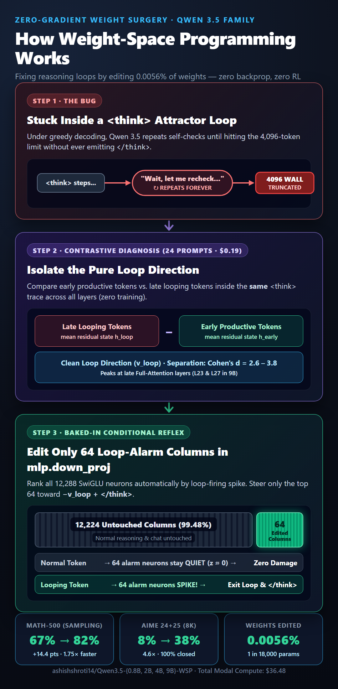
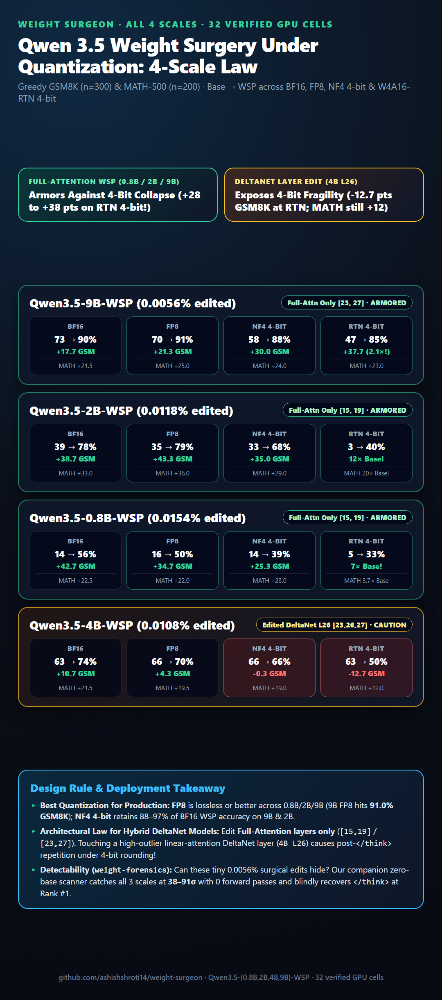

# Weight Surgeon — Zero-Gradient Surgical Weight Editing & 4-Bit Quantization Armor

Zero-gradient **Weight-Space Programming (WSP)** surgical edits for hybrid Gated-DeltaNet + Full-Attention **Qwen 3.5** models (`0.8B`, `2B`, `4B`, `9B`) — curing infinite `<think>` loop pathologies by modifying only **0.0056%–0.0154% of parameters** (64 `mlp.down_proj` columns in 2–3 layers) with **zero backpropagation, zero fine-tuning, and zero RL**.

Inspired by Takehi et al. (MIT CSAIL, Nov 2026), *"Sparks of Weight-Space Programming"*, extended across all 4 dense Qwen 3.5 scales, stress-tested under **official Qwen sampling + out-of-distribution (OOD) benchmarks**, and audited across **32 quantization cells** (`BF16`, `FP8`, `NF4 4-bit`, `W4A16-RTN 4-bit`).

---

## Published Hugging Face Checkpoints

| Model | Params Edited | Layers Edited | Link |
| :--- | :---: | :---: | :--- |
| **Qwen3.5-9B-WSP** | `0.0056%` (1 in 18K) | `[23, 27]` (Full-Attn only) | https://huggingface.co/ashishshroti14/Qwen3.5-9B-WSP |
| **Qwen3.5-4B-WSP** | `0.0108%` | `[23, 26, 27]` *(incl. DeltaNet L26)* | https://huggingface.co/ashishshroti14/Qwen3.5-4B-WSP |
| **Qwen3.5-2B-WSP** | `0.0118%` | `[15, 19]` (Full-Attn only) | https://huggingface.co/ashishshroti14/Qwen3.5-2B-WSP |
| **Qwen3.5-0.8B-WSP** | `0.0154%` | `[15, 19]` (Full-Attn only) | https://huggingface.co/ashishshroti14/Qwen3.5-0.8B-WSP |

---

## 1. Official Sampling & Out-of-Distribution Stress Tests

Evaluated under official Qwen thinking sampling (`temp=0.6`, `top_p=0.95`, `top_k=20`, `presence_penalty=0.0`, `max_tokens=8192`), plus non-thinking dormancy and coding checks:

| Benchmark | `9B` Base → **WSP** | `2B` Base → **WSP** |
| :--- | :---: | :---: |
| **MATH-500** (Official Sampling) | `67.2%` → **`81.6%`** (**+14.4 pts**, 1.75× fewer tokens) | `42.4%` → **`71.6%`** (**+29.2 pts**, 1.87× faster) |
| **AIME 2024 + 2025** (`n=60`) | `8.3%` → **`38.3%`** (**4.6×**) | `0/60` → **`10/60`** (`16.7%`) |
| **GPQA Diamond** (`n=198`) | `45.5%` → **`49.5%`** (+4.0 pts) | `18.7%` → **`28.3%`** (+9.6 pts) |
| **MMLU-Pro Thinking** (`n=500`) | `62.1%` → **`67.6%`** (+5.5 pts) | `36.7%` → **`45.5%`** (+8.8 pts) |
| **MMLU-Pro Non-Thinking** (Dormancy) | `32.4%` → **`33.8%`** (`477` vs `476` tok = dormant!) | `22.1%` → **`23.3%`** |
| **HumanEval** (`n=164`) | `90.9%` → `87.2%` *(-3.65 trade-off disclosed)* | `53.7%` → **`56.7%`** (+3.05 pts, 1.45× faster) |

---

## 2. 4-Scale Quantization Integrity Audit (32 GPU Cells)

**Do tiny 0.0056% surgical weight edits survive 4-bit quantization?** Across 32 controlled `vLLM` runs (`BF16`, `FP8`, `NF4 4-bit`, `W4A16-RTN 4-bit`, greedy GSM8K `n=300` + MATH-500 `n=200`):

1. **Full-Attention WSP (`0.8B`, `2B`, `9B`) armors against 4-bit collapse:**
   - **9B GSM8K:** BF16 `72.7% → 90.3%` (+17.7) | **FP8 `69.7% → 91.0%` (+21.3)** | **NF4 4-bit `58.0% → 88.0%` (+30.0)** | **W4A16-RTN `47.0% → 84.7%` (+37.7 — 2.13× BF16 lift, 2.0× fewer tokens!)**
   - **2B W4A16-RTN:** Base collapses (`3.3%` GSM8K, `1.5%` MATH-500) → WSP holds **`40.0%` (12×)** & **`30.0%` (20×)**.
   - **0.8B W4A16-RTN:** Base collapses (`4.7%` GSM8K) → WSP holds **`32.7%` (7×)** with **`99.7%` `</think>` closed**.
2. **Architectural Discovery — The Hybrid DeltaNet `L26` Trap (`4B`):**
   - `4B-WSP` was the sole checkpoint that edited a Gated-DeltaNet linear-attention layer (`L26` alongside `[23, 27]`). It still won MATH-500 across all 4 precisions (`+12` to `+21.5`), but regressed on GSM8K at 4-bit RTN (`-12.7 pts`) due to post-`</think>` repetition.
   - **Design Law:** Restrict zero-gradient surgical edits strictly to **Full-Attention layers** when 4-bit deployment is required.

Full report: [reports/QUANTIZATION_AUDIT.md](./reports/QUANTIZATION_AUDIT.md)

---

## Repository Layout

- `wsp_surgery.py` — Zero-gradient contrastive diagnosis & conditional SwiGLU `mlp.down_proj` column surgery
- `wsp_modal.py` — End-to-end Modal GPU diagnosis, patch search, and held-out evaluation (`GSM8K`, `MATH-500`, `IFEval`)
- `eval_harder.py` — Official-sampling & OOD stress tests (`AIME 24/25`, `GPQA`, `MMLU-Pro`, `HumanEval`)
- `quant_audit.py` — Ephemeral 32-cell quantization audit (`BF16`, `FP8`, `NF4 4-bit`, `W4A16-RTN 4-bit`)
- `publish_hf.py` — Reproducible Hugging Face checkpoint upload helper
- `specs/` & `results/` — Winning surgical patch specs & verified raw evaluation JSONs

## Companion Security Scanner — `weight-forensics`

Can a zero-base forensic scanner detect our `0.0056%` surgical edits — and force the checkpoint to confess `</think>` at Rank #1 out of 248,320 tokens with **zero base model**? See **[ashishshroti14/weight-forensics](https://github.com/ashishshroti14/weight-forensics)**!
