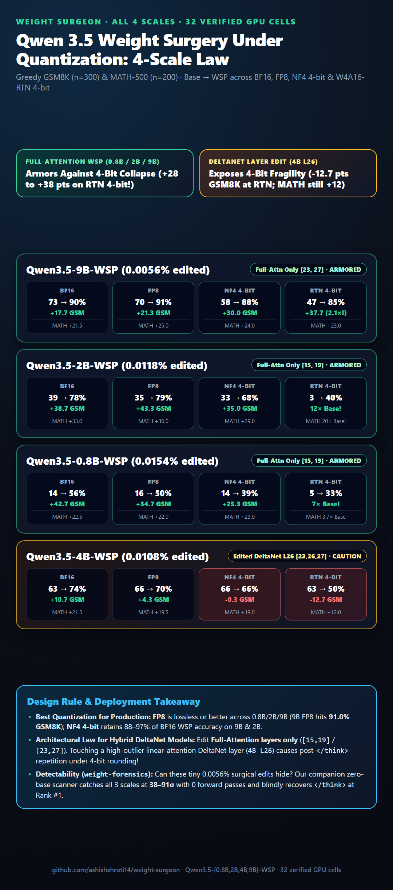

# 4-Scale Quantization Integrity Audit (`Qwen3.5-WSP` Family)

## 1. Executive Summary
- **Question:** Do common 8-bit and 4-bit post-training quantizations (`FP8`, `NF4 4-bit`, `W4A16-RTN 4-bit`) erase ultra-sparse (`0.0056%–0.0154%`) zero-gradient Weight-Space Programming (WSP) edits?
- **Test Setup:** 32 verified GPU evaluation cells across **all 4 scales** (`0.8B`, `2B`, `4B`, `9B`) × **4 precisions** (`BF16`, `FP8`, `BitsAndBytes NF4 4-bit`, `W4A16-RTN 4-bit`), deterministic greedy decoding (`temp=0, presence_penalty=0, max_tokens=4096`) on GSM8K (`n=300`) + MATH-500 (`n=200`).
- **Two Major Discoveries:**
  1. **Full-Attention WSP (`0.8B`, `2B`, `9B`) Armors Against 4-Bit Collapse:** Base Qwen 3.5 collapses into infinite `<think>` loops under 4-bit rounding noise, while WSP survives intact and catches quantization-induced loops too—expanding `9B`'s GSM8K lead from **+17.7 pts (BF16)** to **+37.7 pts (4-bit RTN)** and delivering **7×–20× Base accuracy** on `0.8B` and `2B` at 4-bit RTN.
  2. **The DeltaNet Quantization Trap (`4B L26`):** The **only** model that suffered 4-bit GSM8K regression (`-12.7 pts` at RTN) was `4B-WSP`—the sole checkpoint where a **Gated-DeltaNet linear-attention layer (`L26`)** was edited alongside Full-Attention layers (`[23, 27]`). Design law: **restrict WSP edits to Full-Attention layers when deploying in 4-bit.**

## 2. Verified Numbers Across All 4 Scales

### `Qwen3.5-9B-WSP` (`0.0056%` edited · Full-Attention `[23, 27]`)
- `BF16`: GSM8K `72.7% → 90.3%` (+17.7) | MATH-500 `46.0% → 67.5%` (+21.5)
- `FP8`: GSM8K `69.7% → 91.0%` (+21.3, 121% ret) | MATH-500 `42.5% → 67.5%` (+25.0, 116% ret)
- `NF4 4-bit`: GSM8K `58.0% → 88.0%` (+30.0, 170% ret) | MATH-500 `40.0% → 64.0%` (+24.0, 112% ret)
- `W4A16-RTN 4-bit`: GSM8K `47.0% → 84.7%` (+37.7, 213% ret, 2.0× fewer tokens) | MATH-500 `33.0% → 56.0%` (+23.0, 107% ret)

### `Qwen3.5-2B-WSP` (`0.0118%` edited · Full-Attention `[15, 19]`)
- `BF16`: GSM8K `39.3% → 78.0%` (+38.7) | MATH-500 `26.5% → 59.5%` (+33.0)
- `FP8`: GSM8K `35.3% → 78.7%` (+43.3, 112% ret) | MATH-500 `26.5% → 62.5%` (+36.0, 109% ret)
- `NF4 4-bit`: GSM8K `33.3% → 68.3%` (+35.0, 91% ret) | MATH-500 `23.5% → 52.5%` (+29.0, 88% ret)
- `W4A16-RTN 4-bit`: GSM8K `3.3% → 40.0%` (12× Base) | MATH-500 `1.5% → 30.0%` (20× Base)

### `Qwen3.5-0.8B-WSP` (`0.0154%` edited · Full-Attention `[15, 19]` · `col_steer_signed`)
- `BF16`: GSM8K `13.7% → 56.3%` (+42.7) | MATH-500 `10.0% → 32.5%` (+22.5)
- `FP8`: GSM8K `15.7% → 50.3%` (+34.7) | MATH-500 `9.0% → 31.0%` (+22.0)
- `NF4 4-bit`: GSM8K `13.7% → 39.0%` (+25.3) | MATH-500 `4.0% → 27.0%` (+23.0, 102% ret)
- `W4A16-RTN 4-bit`: GSM8K `4.7% → 32.7%` (7× Base) | MATH-500 `5.0% → 18.5%` (3.7× Base, 99.7% closed)

### `Qwen3.5-4B-WSP` (`0.0108%` edited · `[23, 26, 27]` incl. DeltaNet `L26`)
- `BF16`: GSM8K `63.3% → 74.0%` (+10.7) | MATH-500 `43.0% → 64.5%` (+21.5)
- `FP8`: GSM8K `66.0% → 70.3%` (+4.3) | MATH-500 `44.5% → 64.0%` (+19.5)
- `NF4 4-bit`: GSM8K `66.0% → 65.7%` (-0.3) | MATH-500 `39.5% → 58.5%` (+19.0)
- `W4A16-RTN 4-bit`: GSM8K `63.0% → 50.3%` (-12.7; `</think>` closed 98%, post-`</think>` trunc 50%) | MATH-500 `34.0% → 46.0%` (+12.0)

## 3. Reproducibility
- Audit script: [`quant_audit.py`](../quant_audit.py)
- Raw JSON results: [`results/quant_audit_results.json`](../results/quant_audit_results.json) and [`results/quant_audit_08b_4b.json`](../results/quant_audit_08b_4b.json)
